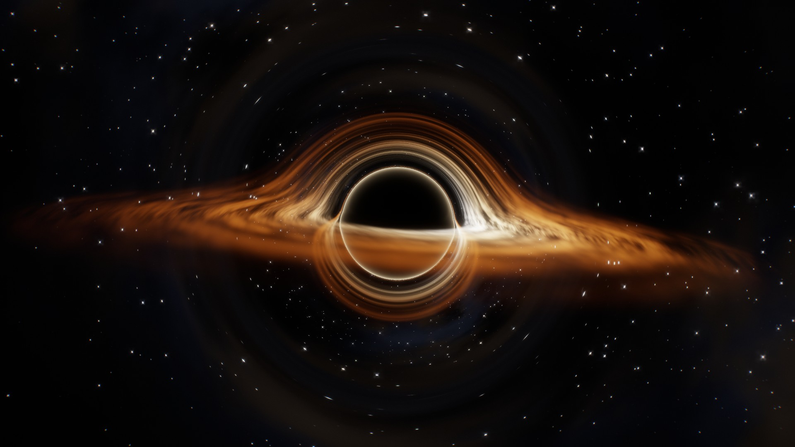
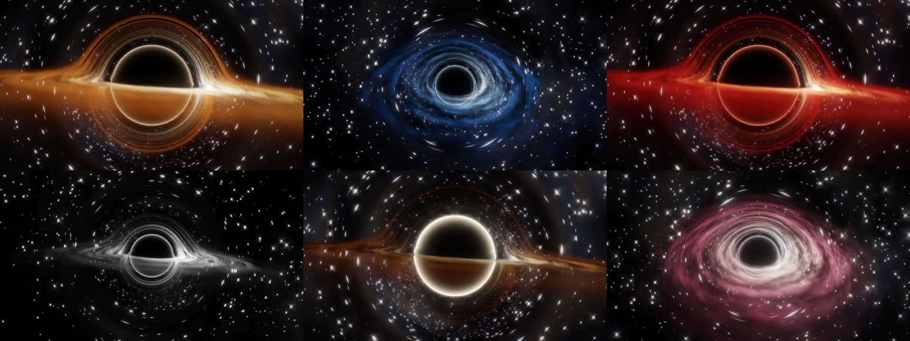

# blackhole-lib

A realtime black hole renderer for C and C++. Light rays bend around the hole and pass through a volumetric, flowing accretion disk. Everything is procedural: there are no textures or meshes. It runs on Vulkan, and the SPIR-V is embedded in the library.



You get the gravitational lensing for free from the ray bending: the back of the disk shows up as an arc over the shadow, a secondary image appears beneath it, a thin photon ring hugs the shadow edge, and stars stretch into arcs around the hole. On top of that come Doppler beaming, gravitational redshift, HDR bloom and ACES tonemapping. The renderer aims for beauty first and physics second.


<sub>Presets: gargantua · frost · crimson / monochrome · void · quasar</sub>

## Features

- **C API** (`blackhole.h`) plus a header-only **C++ wrapper** (`blackhole.hpp`)
- **Offscreen** rendering to RGBA8 memory or straight to PNG, with optional supersampling, which is ideal for wallpapers
- **Window target**: render into any `HWND`, top-level or a child window inside your GUI
- **One parameter struct** controls everything: camera, disk shape, speed and colours, photon ring, sky, post-processing and quality
- Six presets, plus `lerp` to blend smoothly between any two looks
- Transparent background with premultiplied alpha, for overlays
- Static library or DLL. The only dependency is the Vulkan loader.

## Building

Requirements: Windows, Visual Studio 2022 or newer with C++ tools, and the [Vulkan SDK](https://vulkan.lunarg.com).

```bat
build.bat
```

Output in `build\`:

| file | |
|---|---|
| `blackhole_static.lib` | static library. Also link `vulkan-1.lib user32.lib` |
| `blackhole.dll`, `blackhole.lib` | DLL and its import library. Define `BH_USE_DLL` before including the header |
| `viewer.exe` | interactive window (C++ example) |
| `wallpaper.exe` | renders a wallpaper PNG; `--set` applies it to the desktop (C example) |
| `gallery.exe` | renders every preset from several angles (C example, uses the DLL) |

## Usage

### C

```c
#include "blackhole.h"

bh_renderer* r;
if (bh_renderer_create(NULL, &r) != BH_OK) {
    fprintf(stderr, "%s\n", bh_get_last_error());
    return 1;
}

bh_params p;
bh_params_preset(&p, BH_PRESET_FROST);   /* or bh_params_default(&p) */
p.camera_pitch   = 0.3f;
p.ring_color     = (bh_color){1.0f, 0.5f, 0.2f};
p.ring_intensity = 1.5f;
p.render_scale   = 1.5f;                 /* supersampling */

bh_render_png(r, &p, 3840, 2160, "wallpaper.png");
/* or into memory: bh_render_rgba8(r, &p, w, h, pixels, row_stride); */

bh_renderer_destroy(r);
```

### C++

```cpp
#include "blackhole.hpp"

bh::Renderer renderer;
bh::Params p(bh::Preset::Crimson);
p.disk_rotation_speed = 2.0f;

std::vector<uint8_t> rgba = renderer.render(p, 1920, 1080);

bh::WindowTarget target(renderer, hwnd);
while (running) {
    p.time += dt;
    target.present(p);
}
```

To blend between two looks, use `bh::Params::lerp(a, b, t)` or `bh_params_lerp`.

### Wallpaper tool

```bat
wallpaper.exe --preset frost --pitch 0.25 --yaw 1.2 --size 3840x2160 --out frost.png
wallpaper.exe --preset crimson --ring 1,0.3,0.2 --ring-intensity 1.5 --set
```

### Viewer controls

| input | action |
|---|---|
| drag / wheel | orbit / zoom |
| `1`–`6` | switch preset (smooth blend) |
| `F11`, double-click | fullscreen |
| `Space` | pause |
| `+` / `-` | exposure |
| `[` / `]` | render scale |
| `V` | vsync |
| `F12` | save PNG |

## Parameters

Start from `bh_params_default()` or `bh_params_preset()`, then change any field. Distances are in Schwarzschild radii (the event horizon has radius 1) and angles are in radians.

| group | fields |
|---|---|
| animation | `time`: seconds, which you advance yourself |
| camera | `camera_yaw`, `camera_pitch`, `camera_distance`, `camera_roll`, `fov_degrees`, `center_x`, `center_y` (shift the hole on screen) |
| gravity | `lensing` (0 means straight rays) |
| disk | `disk_inner_radius`, `disk_outer_radius`, `disk_thickness`, `disk_brightness`, `disk_opacity`, `disk_rotation_speed` (negative reverses the spin), `disk_flow_period`, `disk_detail`, `disk_streaks`, `disk_temperature`, `doppler_strength`, `redshift_strength` |
| disk colours | `disk_color_edge` → `disk_color_warm` → `disk_color_hot` → `disk_color_core`, plus `disk_color_shift` (highlight on the approaching side) |
| photon ring | `ring_color`, `ring_intensity` (0 = off), `ring_width`, `ring_radius` |
| background | `transparent_background`, `background_color`, `star_density`, `star_brightness`, `milky_way`, `nebula_tint`, `sky_rotation`, `seed` |
| post | `exposure`, `bloom_strength`, `bloom_radius`, `vignette`, `grain`, `chromatic_aberration`, `saturation`, `contrast` |
| quality | `render_scale` (0.25–4), `max_steps`, `step_scale` |

Every field is documented in [`include/blackhole.h`](include/blackhole.h).

## Errors and threading

Functions return a `bh_result`: `BH_OK` is 0, `BH_SKIPPED` is 1, and errors are negative. The message for the last failure is in `bh_get_last_error()`. The C++ wrapper throws `bh::Error` instead.

To enable Vulkan validation, set `bh_renderer_desc.enable_validation = 1`; in the examples, set the `BH_VALIDATE=1` environment variable.

A renderer, and everything created from it, must be used from one thread at a time.

## Performance

On an RTX 5060, a frame at 2560×1440 takes about 20 ms (roughly 50 fps). Most of the cost is the volumetric disk. To trade quality for speed, lower `render_scale` or `max_steps`.

## How it works

Each pixel marches a ray through Schwarzschild-like gravity, using the classic `a = -1.5·h²·r/|r|⁵` photon trick. Inside the disk slab the ray accumulates emission and absorption from anisotropic fBm noise. The noise is advected by differential (Keplerian) rotation using a two-phase flow map, so the gas never winds up. The HDR frame is downsampled into a mip chain for bloom, then tonemapped in a composite pass.

## License

[MIT](LICENSE)
